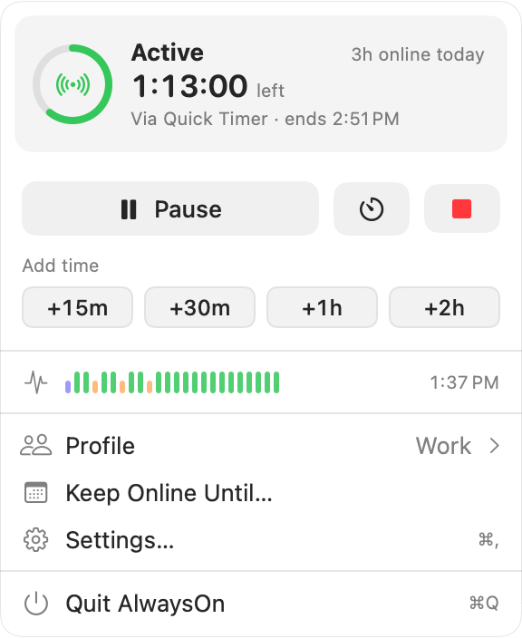
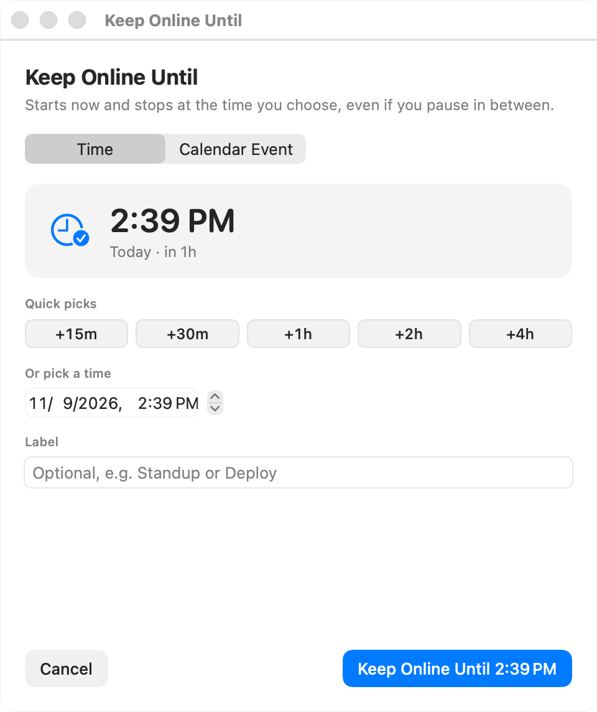
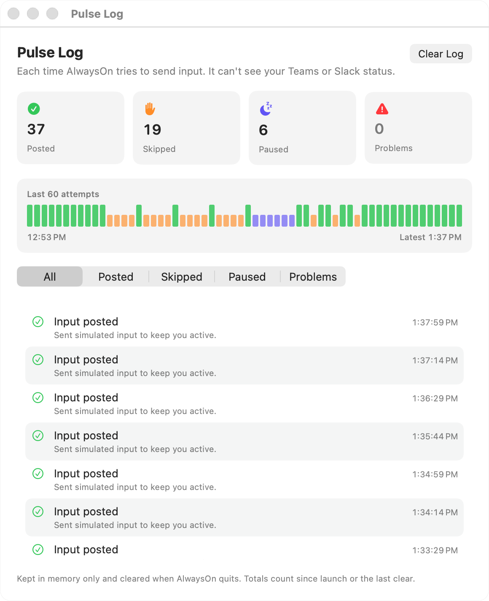
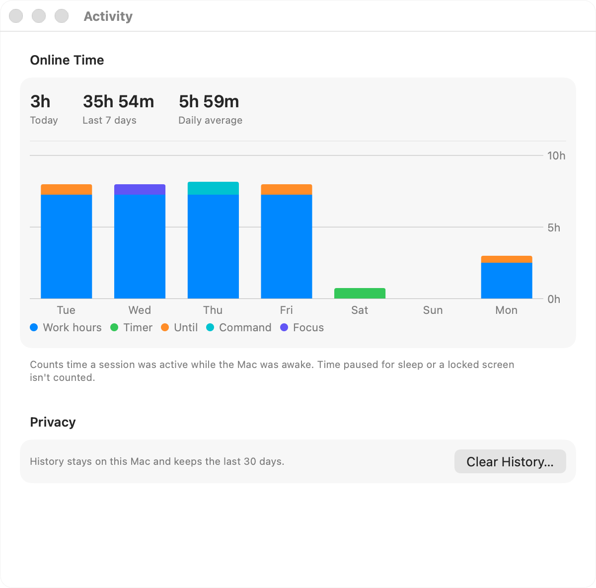

<p align="center">
  
</p>

# AlwaysOn

AlwaysOn is a macOS menu bar app that keeps you shown as active in Microsoft Teams, Slack, Zoom, and other workplace apps. It does this by sending a tiny input on an interval: a 1-pixel mouse move or a Shift key press.

<p align="center">
  <picture>
    <source media="(prefers-color-scheme: dark)" srcset="screenshots/menu-dark.png">
    
  </picture>
</p>

If you find this app useful, consider supporting its development:

<a href="https://buymeacoffee.com/hafiezul" target="_blank"></a>

## At a glance

- Runs on macOS 13.0 or later.
- Needs Accessibility permission. Notifications, Location, and Calendar access are optional.
- Lives in the menu bar and has no Dock icon.
- Updates itself from GitHub Releases.

## Features

- Start, pause, resume, or stop a session from the menu bar.
- Toggle the session from any app with a global hotkey (⌥⌘K, or record your own).
- Pause for 15 minutes to 2 hours and resume on its own.
- Send mouse input, keyboard input, or alternate between them.
- Use adaptive pacing to send input only after you've been idle, which cuts wake-ups.
- Keep the Mac, or the Mac and display, awake during a session.
- Save energy in Low Power Mode or when the Mac runs hot.
- Skip input while you're using the Mac, or while no chat or meeting app is running.
- Pause while the Mac sleeps, locks, or switches users.
- Run quick timers, or start sessions on a work hours schedule with per-day hours, a daily break, and days off.
- Keep online or switch profiles while a macOS Focus is on.
- Keep online until a chosen time or until a calendar event ends.
- Keep online while a terminal command runs, with the `alwayson` CLI.
- Review recent input attempts in the Pulse Log.
- See daily online time for the last week in Settings > Activity.
- Optionally share anonymous, rounded usage statistics. They're off until you turn them on.
- Stop on its own after you've been away too long or the battery runs low.
- Control sessions from Shortcuts, Spotlight, Siri, and `alwayson://` links.
- Launch at login and show optional notifications.
- Save profiles for different setups, and switch profiles when you join a Wi-Fi network.

## Getting started

### Install a release

1. Download the latest DMG from the [Releases page](../../releases/latest).
2. Open the DMG and drag `AlwaysOn.app` to Applications.
3. Launch AlwaysOn from Applications.
4. If macOS says Apple could not verify the app is free of malware, open **System Settings > Privacy & Security**, scroll to **Security**, click **Open Anyway** for AlwaysOn, then confirm **Open Anyway**.
5. The setup window lists every permission AlwaysOn uses. Allow **Accessibility**, which is required. The others are optional: **Notifications**, **Location** (for Wi-Fi profile switching), and **Calendar** (for keeping online until a meeting ends). You can change them later in **Settings > General > Permissions**.

From then on, AlwaysOn updates itself (see [Permissions and updates](#permissions-and-updates)). AlwaysOn signs every release with the same certificate, so Accessibility access carries over to each new version.

If your current version has no **Settings > Updates > Check for Updates…** button, install the new release from the DMG once. Then remove the old AlwaysOn entry from **System Settings > Privacy & Security > Accessibility**, add `/Applications/AlwaysOn.app`, and turn it on. Later updates won't need this step.

### Build from source

You need Xcode 15 or later, Swift 5.9 or later, and the macOS 13 SDK.

```bash
git clone https://github.com/hafiezul/AlwaysOn.git
cd AlwaysOn
open AlwaysOn.xcodeproj
```

Xcode fetches the Sparkle package the first time you open the project. Build and run, then grant Accessibility permission when macOS asks.

A local build has no update signing key, so it can't update itself. **Settings > Updates** offers a manual check of the latest GitHub release instead. [CODESIGNING.md](CODESIGNING.md) explains how releases are signed and built.

## How it works

Every 45 seconds by default, AlwaysOn sends one of these inputs:

- Mouse sends a mouse event at the pointer's current position, without moving it.
- Keyboard presses and releases the Shift key.
- Alternating switches between the two.

While another app plays video (anything keeping the display awake, such as a browser, QuickTime, IINA or VLC), AlwaysOn sends the Shift key instead of mouse input, so video players don't show their controls.

Many workplace apps set your status from the macOS idle time. Each input resets it.

### Pacing

**Settings > General > Activity > Pacing** decides when AlwaysOn sends input.

- **Fixed interval** (the default) sends input every interval, whether or not you're using the Mac.
- **Adaptive** sends input only after the Mac has been idle for 1, 2 (the default), or 4 minutes. Between checks it sleeps until the next input would be due. While you type, it sends nothing and wakes about once every couple of minutes instead of every 45 seconds.

Adaptive pacing lets idle time grow past a minute, so a few things change with it:

- If your screen saver would start before the chosen idle time, AlwaysOn shortens the idle time so input arrives first.
- During a session, AlwaysOn holds a display-sleep assertion so the display doesn't sleep and lock. With a fixed interval, the input itself keeps the display on.
- AlwaysOn releases that assertion while the target-app option finds none of your apps running.

### Power use

AlwaysOn wakes the CPU only when something can change.

- Simulation pauses while the Mac sleeps or another user is switched in. When you return, AlwaysOn sends one input right away and carries on.
- By default it also pauses while the screen is locked. Most chat apps show you as Away on a locked Mac anyway, and input sent to the lock screen keeps waking the display. Turn off **Settings > General > Pause while screen is locked** to keep sending input while locked.
- The session clock ticks every second only while the menu is open or during a timer's last minute. Otherwise it wakes when the menu bar countdown changes. An unlimited session with the menu closed runs no clock at all.
- Work hours wake AlwaysOn at the schedule's start and end instead of every minute. AlwaysOn re-checks deadlines and the schedule after the Mac wakes and after a clock or time zone change.
- The target-app option listens for app launches and quits instead of scanning running apps on every tick.
- AlwaysOn checks Accessibility permission when you open the menu, start a session, and on each tick, not on a 10-second loop. While you're granting it, AlwaysOn checks every second for up to two minutes.
- Timers carry a tolerance so macOS can batch their wake-ups.
- **Save energy in Low Power Mode or when hot** is on by default. While Low Power Mode is on or the thermal state is serious, it doubles a fixed interval (up to 2 minutes) and gives wake-ups more slack. AlwaysOn learns about both from system notifications.

### Prevent sleep

**Settings > General > Power > Prevent sleep** keeps the Mac, or the Mac and display, awake during a session even when AlwaysOn sends no input. That covers times when no target app is running and commands run with `alwayson run`.

It uses a macOS power assertion, which costs nothing while held. AlwaysOn releases it when the session pauses or stops, the Mac sleeps, or another user is switched in. While the screen is locked, only the Mac stays awake. Closing the lid still puts the Mac to sleep.

## The menu

The menu opens with a status card. It shows whether AlwaysOn is keeping you online, the time left (or time elapsed, for a session with no end), what started the session, when it ends, and today's online time. A ring empties as a timed session runs out.

- **Keep Online / Pause / Resume** is the main button. Press ⌘K in the menu, or the global hotkey from any app. The stop button next to it ends the session.
- **Pause for…** (the timer button, shown while a session runs) pauses for 15 minutes, 30 minutes, 1 hour, or 2 hours, then resumes on its own. The status card shows when.
  - Resuming by hand, stopping, or starting another session cancels the scheduled resume.
  - A session's end time still applies while it's paused.
  - If the Mac sleeps past the resume time, the session resumes when the Mac wakes.
  - AlwaysOn keeps a timed pause in memory, so quitting AlwaysOn clears it.
- **Keep online for** 30m, 1h, 2h, or 4h starts a timed session in one click. During a timed session the same row becomes **Add time** (+15m to +2h). During an unlimited session it becomes **Stop after**.
- Short notices explain the current state. They say why the last session ended (a timer, work hours, a Focus turning off, a revoked permission, or a safety stop). They also say when simulation is waiting for a target app and when work hours next start or end. On a workday, **Skip Today** next to the work hours notice turns off today's work hours, and **Undo** brings them back.
- A strip of the latest input attempts shows what AlwaysOn has been sending. Click it to open the Pulse Log.

**Settings > General > Activity > Global hotkey** turns the system-wide shortcut on or off. Click the shortcut to record a new one. It must include ⌘, ⌥, or ⌃ unless it's a function key. Esc cancels recording, and **Reset** returns to ⌥⌘K. If another app already uses the shortcut, Settings tells you.

**Settings > General > Menu Bar** shows either the icon alone or the icon with the time left. With the icon alone, AlwaysOn wakes for a timed session only when it ends.

## Keep online until a set time

Choose **Keep Online Until…** in the menu to start a session now that stops at a time you pick. The window has two tabs.

<p align="center">
  <picture>
    <source media="(prefers-color-scheme: dark)" srcset="screenshots/keep-online-until-dark.png">
    
  </picture>
</p>

- **Time** shows the chosen end time in large type, with how far away it is. Use a quick pick (**+15m** to **+4h**, or **End of work hours** while work hours are under way), or pick any date and time. You can add a label.
- **Calendar Event** lists events after you choose **Load Calendar Events**. Pick a timed event that is in progress (marked **Now**) or starts in the next 24 hours. The session takes the event's title as its label and stops when the event ends.

The start button names the result, for example **Keep Online Until 5:30 PM**.

AlwaysOn copies the end time when the session starts. If the event later moves or gets shorter in Calendar, the session keeps the copied time. AlwaysOn doesn't detect meetings or start sessions for them on its own.

While the session runs, the menu shows its end date and time and a countdown. The end time is fixed:

- If you pause, the session still ends at that time. Resuming continues toward the same end time.
- If AlwaysOn quits during the session, it resumes the session on relaunch only if the end time is still in the future.
- **Cancel Timer** removes the end time and keeps the session running with no limit.

AlwaysOn won't start the session if the time has passed or Accessibility permission is missing. In both cases the current session keeps running unchanged.

AlwaysOn asks for calendar access only when you choose **Load Calendar Events**. It reads event titles and times and never changes your calendar. If you deny access, the **Time** tab still works. To allow access later, open **System Settings > Privacy & Security > Calendars**. On macOS 14 and later AlwaysOn needs **Full Access**, because add-only access can't read events.

## Check what AlwaysOn sent

Click the activity strip in the menu to open the Pulse Log. It shows totals for Posted, Skipped, Paused, and Problems, a timeline of the last 60 attempts, and a list you can filter by category. Each entry shows its time, its outcome, and the reason.

<p align="center">
  <picture>
    <source media="(prefers-color-scheme: dark)" srcset="screenshots/pulse-log-dark.png">
    
  </picture>
</p>

- **Input posted** means AlwaysOn sent the mouse or Shift input.
- **Skipped: user active** means you used the Mac recently. That's within the last 30 seconds with **Only simulate when idle**, or within the idle time you chose for adaptive pacing.
- **Skipped: no target app** means none of your chosen chat or meeting apps was running while that option was on.
- **Input creation failed** means macOS didn't create the input event.
- **Input had no effect** means AlwaysOn posted the input, but the Mac's idle time didn't reset by the next attempt. See [Your status still goes idle](#your-status-still-goes-idle).
- **Paused: Mac asleep, locked, or switched user** means simulation stopped until the Mac is in use again.
- **Stopped: Accessibility permission missing** means someone revoked the permission, so the session stopped.
- **Stopped: away limit reached** and **Stopped: low battery** mean a [safety stop](#safety-stops) ended the session.

The list shows the newest 200 entries. The totals count from launch or the last clear, and **Clear Log** resets both. The log lives in memory and disappears when AlwaysOn quits. It records what AlwaysOn sent, not the status Teams, Slack, or other apps show.

## Work hours

**Settings > Schedule** starts a session when work hours begin. When they end, it stops a session that work hours started. Manual starts and stops always win.

- **Hours by Day** gives a weekday its own hours, such as a shorter Friday. Other days use the default start and end.
- **Break** pauses work hours at the same time every day, such as lunch. A session that work hours started stops at the break and starts again when the break ends.
- **Days Off** lists dates with no work hours, such as holidays. **Skip Today** in the menu adds today. AlwaysOn clears past dates on its own.

Work hours wake AlwaysOn only at the next start, break, or end.

## Focus filters

Add AlwaysOn to a Focus in **System Settings > Focus > (a Focus) > Focus Filters**, then choose **Keep Me Online**, a profile, or both.

- When the Focus turns on, AlwaysOn switches to the chosen profile. Like any profile switch, this stops the current session. With **Keep Me Online**, AlwaysOn then starts a session if none is running.
- When the Focus turns off, AlwaysOn stops the session the Focus started and returns to the previous profile, unless you picked another profile in the meantime. If your own session is running, the switch back waits until it ends, and the menu says so. If you pause and resume a Focus session yourself, it becomes yours and keeps running.
- AlwaysOn re-reads the Focus at launch, after the Mac wakes, and when you open the menu, so it catches changes it missed.

## Switch profiles by Wi-Fi network

Turn on **Settings > Profiles > Switch profiles by Wi-Fi network**. While connected to a network, click a profile's Wi-Fi button and choose **Use on "network"**. Joining that network later switches to that profile. Each network belongs to one profile.

- A running or paused session always finishes first. The menu names the profile that will apply when it ends.
- A network applies its profile once per join. If you pick another profile by hand, it stays until you join a different network.
- If the new profile's work hours are under way, its schedule starts the session.

macOS shows Wi-Fi network names only to apps with Location access, so turning this on asks for it. AlwaysOn reads the network name and never your position. macOS reports network changes as events, so AlwaysOn doesn't poll.

## Activity history

**Settings > Activity** shows today's online time, the total for the last 7 days, and a daily chart. The chart splits each day by what started the session: manual, work hours, timer, Until, command, or Focus. The menu shows today's total next to the status.

<p align="center">
  <picture>
    <source media="(prefers-color-scheme: dark)" srcset="screenshots/settings-activity-dark.png">
    
  </picture>
</p>

Online time counts while a session is active and the Mac is awake. Time paused for sleep, a locked screen, or a switched-out user doesn't count.

History stays on this Mac in `~/Library/Application Support/AlwaysOn/activity-history.json` and keeps the last 30 days. AlwaysOn writes it when a session starts or stops, plus a checkpoint at most every 5 minutes. **Clear History…** deletes it.

## Safety stops

**Settings > General > Safety** has two optional limits that end a session on their own. Both are off by default.

- **Stop after I'm away for** 1, 2, 4, or 8 hours ends the session once you haven't touched the keyboard or mouse for that long. AlwaysOn tells your input apart from its own, so its input doesn't reset the clock. Starting or resuming a session counts as being present.
- **Stop on low battery** at 10, 20, 30, or 50% ends the session when the battery drops to that level while unplugged, and won't start a session below it. AlwaysOn follows the power source through macOS notifications instead of polling.

A safety stop shows in the menu and the Pulse Log. With notifications on, it also sends a notification.

## Shortcuts, Siri, and links

### Shortcuts

AlwaysOn adds these actions to the Shortcuts app:

- **Keep Online**, with optional minutes (1 to 1440)
- **Keep Online Until** a date and time, with an optional label
- **Pause or Resume**, which returns whether AlwaysOn is now active
- **Pause For**, with optional minutes (1 to 1440), which resumes on its own
- **Stop Session**
- **Switch Profile**, which stops the current session, the same as switching from the menu
- **Get Status**, which returns whether AlwaysOn is active

They follow the same rules as the `alwayson://` links and report an error if Accessibility permission is missing. In Spotlight and Siri, say "Start AlwaysOn", "Keep me online with AlwaysOn", "Stop AlwaysOn", or "AlwaysOn status".

### Links for launchers

AlwaysOn registers the `alwayson://` URL scheme, so launchers like Raycast and Alfred can control it:

- `alwayson://start` starts a session.
- `alwayson://stop` stops the session.
- `alwayson://toggle` starts or pauses.
- `alwayson://timer?minutes=30` keeps you online for 30 minutes. Leave out `minutes` to use the profile's default.
- `alwayson://pause?minutes=15` pauses a running session and resumes it after 15 minutes (1 to 1440). Leave out `minutes` to pause until you resume.
- `alwayson://until?date=2026-11-09T17:30:00Z` keeps you online until an ISO 8601 date and time in the future.

## Keep online while a command runs

AlwaysOn.app includes a native `alwayson` command-line tool. It needs the installed app, with Accessibility permission already granted. It doesn't need Python.

### Install the CLI

Open **Settings > General > Command Line Tool** and click **Install**. The section shows whether the tool is installed, its path, and the bundled version and build. **Uninstall** removes this app's link. If another copy of AlwaysOn owns the link, **Use This App** points it at the current copy.

You can also install from the terminal:

```bash
"/Applications/AlwaysOn.app/Contents/Helpers/alwayson" install
# If ~/.local/bin is not on your PATH, add this to your shell configuration:
export PATH="$HOME/.local/bin:$PATH"
```

`install` creates a symlink in `~/.local/bin`, or in the directory you pass with `--directory PATH`. It won't replace files or symlinks it didn't create. `alwayson uninstall [--directory PATH]` removes only this app's link.

The symlink points into the app bundle, so it keeps working when you replace the app at the same path. `alwayson --version` (or `alwayson version`) prints that app's version and build. The CLI has no version of its own. Commands always go to the app that owns the link, even with several copies of AlwaysOn installed. Your shell needs `~/.local/bin` on PATH only to find `alwayson` by name.

### Commands

```bash
alwayson start
alwayson stop
alwayson toggle
alwayson timer 30        # whole minutes, 1 to 1440
alwayson pause [15]      # optional whole minutes, 1 to 1440
alwayson until 17:30     # or an ISO 8601 date and time
alwayson run -- make test
```

`until HH:MM` must be later today. It never rolls over to tomorrow.

These commands exit successfully once macOS delivers the request to the app. The app doesn't send back a confirmation.

### Run a command

Put the command after `--`:

```bash
alwayson run -- make test
alwayson run -- python3 long_job.py
```

The helper runs the command with its arguments unchanged and without a shell. Output streams to your terminal as the command writes it, and the helper exits with the command's exit status. If a signal kills the command, the exit status is 128 plus the signal number, as in a shell.

### How the helper starts and stops sessions

Before the command starts, the helper opens `alwayson://run?token=UUID`. After the command exits, it opens `alwayson://finish?token=UUID` with the same token. Each run gets a new token. AlwaysOn ignores a `run` or `finish` URL with a missing, malformed, or reused token.

- A `run` request replaces the current session, and the menu shows the session's end time. If Accessibility permission is missing, AlwaysOn asks for it and keeps the current session.
- A `finish` request stops the session only if its token matches the current command session.
- The latest command wins. When overlapping commands finish, an older command can't stop a newer session.
- Pausing, resuming, starting another session, cancelling the timer, stopping, or switching profiles takes the session away from the command. A later `finish` from that command does nothing.
- After you pause and resume, the session keeps the command's 24-hour safety end time.

Ctrl-C goes straight to the command. The helper waits for the command to exit, then releases the session. If the helper itself gets SIGTERM (from `kill`, for example) or SIGHUP (when the terminal closes, for example), it passes the signal to the command and still releases the session.

### Limits

- The app doesn't acknowledge URL requests. A delivered request doesn't confirm that permission is granted, that the session started, or the order requests arrived in.
- If the helper exits without sending `finish` (after SIGKILL, for example), the session stops at its 24-hour safety end time.
- Command sessions don't resume after AlwaysOn relaunches.
- AlwaysOn prevents idle sleep during a command only when **Settings > General > Power > Prevent sleep** is on, or when its input keeps the Mac awake. Closing the lid always puts the Mac to sleep.

### Develop the CLI

```bash
swift build --package-path CLI
python3 CLI/Tests/acceptance.py CLI/.build/debug/alwayson
```

The package has no external dependencies. The tests copy the built executable into app fixtures and swap the system URL opener for a stub through `ALWAYSON_URL_OPENER`. On macOS, real requests go through Launch Services with running-app substitution turned off.

A build outside the app bundle supports `help` and `version` but refuses to install or send commands. Install the full app for those. The CLI package builds on Linux, but the macOS app doesn't run there.

## Permissions and updates

- AlwaysOn needs Accessibility permission to send keyboard and mouse input.
- Calendar access is optional. AlwaysOn asks for it only when you allow it in the setup window or load events in the **Keep Online Until…** window.
- Location access is optional. AlwaysOn asks for it only to read Wi-Fi network names for profile switching.
- AlwaysOn checks [GitHub Releases](../../releases/latest) for updates once a day and offers to install them. In **Settings > Updates** you can check now, turn off the daily check, or have updates download and install on their own.
- AlwaysOn installs an update only if its EdDSA signature matches the key built into the app.
- AlwaysOn signs releases with its own self-signed certificate, not an Apple Developer ID. macOS asks you to confirm the first launch. Because the certificate stays the same, Accessibility access survives updates. See [CODESIGNING.md](CODESIGNING.md).
- AlwaysOn collects no data unless you turn on usage statistics. See [Usage statistics](#usage-statistics).

## Usage statistics

Usage statistics are off unless you turn them on, in the setup window or in **Settings > General > Usage Statistics**. If you haven't turned them on, the menu may ask at most twice, 30 days apart, and never while a session runs. The setup window's switch counts as the first time. Turning statistics off, or answering the second time, ends the asking. When they're on, AlwaysOn sends these events to [PostHog](https://posthog.com):

- `telemetry_enabled` when you turn statistics on, and where you did it: setup, Settings, or the menu.
- `app_updated` on the first launch of a new version, with the version you updated from.
- `first_session_started` for your first session after turning statistics on, with how it started (manual, timer, work hours, and so on).
- `daily_summary` once a day: the settings you use (pacing, input method, safety stops, power options, and which features are on), counts of sessions started, sessions that ended on their own, and failed inputs since the last summary, and your online time in the last 24 hours. Counts and times are rounded into ranges such as "2-5" or "1-2h".

Every event also carries your AlwaysOn version, your macOS version (major and minor only), and whether the Mac uses Apple silicon or Intel. Events are tied to a random ID that AlwaysOn makes when you turn statistics on. The ID isn't derived from your Mac or your account.

AlwaysOn never sends your name, profile names, Wi-Fi network names, calendar events, which apps you run or target, schedule times, your hotkey, or anything you type. Events ask PostHog not to look up a location or build a person profile, and PostHog discards the sender's IP address instead of storing it with events. To see the exact next summary, expand **Show the next daily summary** under the switch in Settings.

Turning statistics off stops sending and deletes the random ID and the counts kept on your Mac. If you turn them on again, AlwaysOn starts with a new, unlinked ID. Builds you make yourself in the Debug configuration print events to the console instead of sending them.

After two weeks and ten sessions, the menu asks once whether you'd like to star AlwaysOn on GitHub. It never asks again, whichever you choose.

## Troubleshooting

### macOS says the app could not be verified

Launch AlwaysOn once. Then open **System Settings > Privacy & Security**, scroll to **Security**, click **Open Anyway** for AlwaysOn, and confirm **Open Anyway**. macOS remembers this choice for later launches.

### Accessibility permission isn't working

This can happen once when you move from an older release to one that updates itself, or after you build the app yourself. Remove any old AlwaysOn entry from **System Settings > Privacy & Security > Accessibility**, add `/Applications/AlwaysOn.app`, turn it on, and relaunch AlwaysOn.

### Your status still goes idle

Check that Accessibility permission is on and that AlwaysOn shows an active session. Open the Pulse Log to see whether AlwaysOn is posting input or skipping it. Also check whether a custom status in your chat app overrides your presence.

If the Pulse Log shows **Input had no effect**, macOS is dropping AlwaysOn's input even though the permission looks on. Remove AlwaysOn from **System Settings > Privacy & Security > Accessibility**, add `/Applications/AlwaysOn.app` again, turn it on, and relaunch AlwaysOn.

## License

MIT License. See [LICENSE](LICENSE).

## Contributing

Open an issue, start a discussion, or send a pull request on GitHub.
